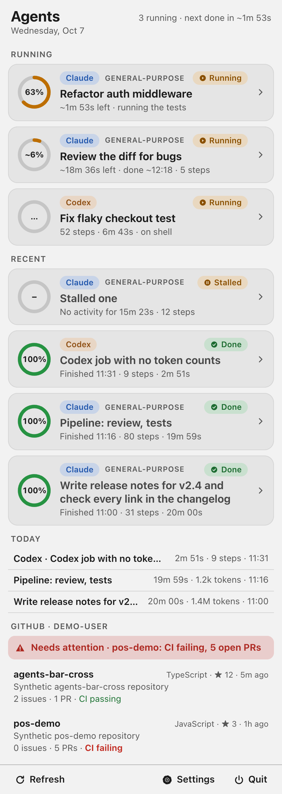
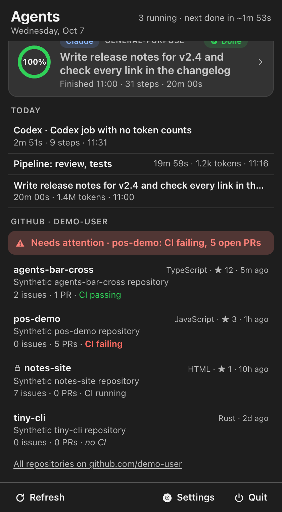
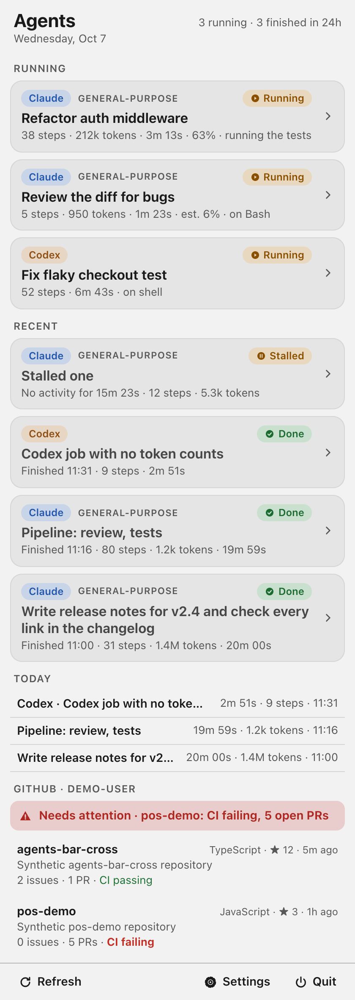
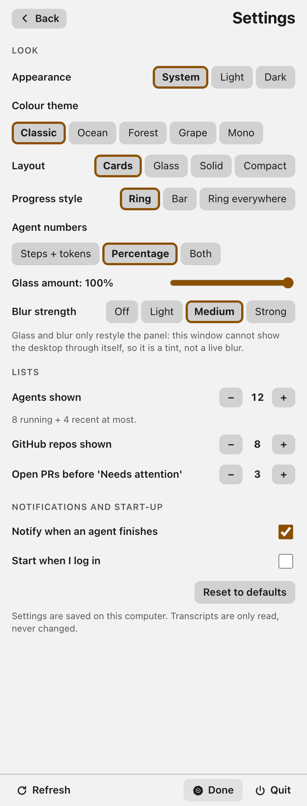

# Agents Bar (cross-platform)

A tray / menu-bar app for **Windows, Linux and macOS** that shows your running and finished **Claude Code** and **Codex** agents, plus your GitHub repositories with CI status. It is a separate app with its own tray icon (a Tauri v2 shell with a Preact popup). It is the cross-platform sibling of the Mac-only [agents-bar](https://github.com/RezzAk47/agents-bar) and follows its behaviour. Both are based on CLI-Usage by Nima Ansari (see Credit).

**Status: early.** Tested on macOS only. Windows and Linux builds are untested, and the release workflow has not been run yet. Downloads will be unsigned, so Windows SmartScreen and macOS Gatekeeper will warn. Not affiliated with Anthropic or OpenAI; Claude and Codex are their owners' trademarks.






All screenshots use **synthetic** agents and repos. More screenshots: [docs/GALLERY.md](docs/GALLERY.md)

## What it does

- Reads the agents' own transcript files (read-only, never writes or changes them): Claude Code subagents under `~/.claude/projects/*/*/subagents/agent-*.jsonl` (Windows `%USERPROFILE%\.claude\projects`) and Codex sessions under `~/.codex/sessions/*/*/*/rollout-*.jsonl`.
- **Running / Recent cards** with state word and symbol (Running, Done, Stalled), a ring (or bar) with the percent, or steps and tokens, per the *Agent numbers* setting: **Percentage** (default here), **Steps + tokens**, **Both**.
- Percent: the agent's own `PROGRESS: 40% - note` line (uppercase, line start; 100 shows as 99 until it hands back), else an estimate from finished agents with a similar task, the same kind, or the same tool (`~63%`). ETA and "taking longer than usual" follow the Mac rules.
- **Tray text** `3 running · 2 finished` (tooltip everywhere, title next to the icon on macOS). **Today** list. **Finish notifications** (one per finish, never for agents already done when the app starts, more than 3 in one scan become one "N agents finished"; a failed delivery is retried at most 3 times, saved across restarts).
- **GitHub** via the `gh` CLI you are logged into: issues, PRs, latest CI result (`CI failing` is always words, calm red), **Needs attention** (failing CI or more open PRs than your threshold, naming the repos, `+N`). Errors (gh missing, not logged in, rate limit, timeout) are explained and the last good list stays.
- Settings: appearance, 5 themes, layouts (cards, glass, solid, compact), progress style, glass amount, blur, agents shown (3 to 20, split about 2/3 running), repos shown, PR threshold, notifications, start at login. Unknown keys in `settings.json` are kept.

## Run

Requirements: Node 24+, Rust **1.90** or newer, the Tauri v2 platform packages (Linux: WebKitGTK 4.1 and an AppIndicator library, see `.github/workflows/ci.yml`).

```
npm ci
npm run tauri build -- --debug     # or: npm run tauri dev
```

**Build the app with `tauri build` (or `tauri dev`), never plain `cargo build --release`.** A plain cargo build is not given the Tauri `custom-protocol` feature, so it does not embed the page and shows a blank window.

Tests and checks: `npx vitest run`, `npx tsc --noEmit`, `cd src-tauri && cargo test && cargo clippy --all-targets -- -D warnings`, `npm run build && npm run ui:smoke && npm run shots`, perf: `cargo test --release perf_300 -- --ignored --nocapture`.

### Where things live and environment overrides

| | macOS | Windows | Linux |
|---|---|---|---|
| App data (settings.json, notified.json) | `~/Library/Application Support/AgentsBarCross` | `%APPDATA%\AgentsBarCross` | `${XDG_DATA_HOME:-~/.local/share}/AgentsBarCross` |

It never touches `~/.agents-bar` (the Mac bars' folder). Overrides: `AGENTSBAR_DATA_DIR`, `AGENTSBAR_CLAUDE_DIR`, `AGENTSBAR_CODEX_DIR`, `AGENTSBAR_GH` (path of the gh executable; tests use `scripts/fake-gh.sh`), `AGENTSBAR_NO_NOTIFICATIONS=1` (nothing is sent to the OS, finishes are still recorded). These four path overrides are **test hooks: debug builds honour them, release builds ignore them** unless the run sets `AGENTSBAR_TEST=1`, so a stray variable in your environment cannot redirect a normal run.

## Design: who does what (one source of truth)

- **Rust (`src-tauri/src/scanner.rs`)** owns every transcript byte: the folder walk (24 h lookback, newest 300 files per tool, symlinks to files and to folders never followed, only regular files opened, entry cap), per-file offsets, line splitting (half-written last line waits; a line over 4 MB is skipped without being held in memory, and the skip is remembered and counted against the read budget, so a huge file without newlines costs one budget per tick instead of a re-read), replaced/truncated file detection (inode, size, first 64 bytes), per-call read budgets (4 MB per file, 8 MB per call), and **slimming**. A line nested too deep for the JSON reader is skipped, the rest of the file is kept.
- **A big first start is one incomplete pass.** While a pass is not finished (`more = true`) the page shows "Scanning transcripts…", judges no states and announces no finishes; the first complete pass is the baseline, so a cold start never produces false "Agent finished" alerts.
- **TypeScript (`src/core`)** owns all meaning: states, steps, tokens (per `message.id` the max of each field; Codex latest `total_token_usage`), percent, ETA, finish watcher, Today, GitHub parsing and text, settings. It is pure and unit tested. The Rust slimmer is tested against the same fixtures (`tests/fixtures/transcripts` are slimmed by `cargo test slim_golden` into `tests/fixtures/slim`; `tests/fixtures.test.ts` checks that full and slim records give identical results).
- **Ticks:** Rust emits a tick every 3 s; the page rescans changed files only (one `stat` per known file) and does a folder walk on every 10th tick.
- **GitHub (`gh.rs`)** only runs three fixed shapes: `gh api user --jq .login`, `gh repo list --limit N --json <fixed list>`, `gh run list --repo OWNER/NAME --limit 1 --json status,conclusion`. No shell, 10 s timeout per call (killed), 8 MB output cap, owner/repo validated before use in argv. Opening a repo or revealing a transcript is a Rust command: the URL is built from validated names (`https://github.com/<owner>/<repo>`), and a transcript can only be revealed if the scanner itself found it.
- **Shell:** tray, popup positioning, single instance, autostart and the file store (compare-and-swap, lock file, symlink policy, UTF-8/BOM handling) follow the same design as the author's Tasks Bar cross-platform app (not yet released). Capabilities list only the commands above plus notification and autostart; the CSP allows only the app's own files.

## What the page receives (privacy)

Transcripts can hold private prompts, code and file contents. The page gets only this, and a test (`npm run privacy`, `scanner.rs` canary tests) plants unique strings in every other place and fails if one crosses into the Rust output or the rendered page:

- per record: the timestamp, the record type, message and request ids, token counts, tool names and call ids;
- lines of an agent's reply that are `PROGRESS: NN% - note` report lines (the marker onward, at most 400 characters), nothing else of any reply;
- Codex: **one** text per file, the first user prompt that is not injected context (AGENTS.md, environment), whitespace-collapsed and cut to 200 characters (the page shows 80); later user turns, tool arguments and outputs are never sent;
- Claude subagents: the `description` and `agentType` from the sibling `.meta.json` (that is the task title shown on the card), cut to 400 characters;
- file paths (to show the project name in a notification and to reveal a transcript in the file manager).

Nothing is written anywhere except `settings.json` and `notified.json` in the app's own data folder.

## Notifications

They are sent from Rust (`notify` command, the notification plugin's Rust API), so the page learns about a real error (permission denied, no notification daemon) and the persisted retry (at most 3) is driven by it. **Honest limit:** the OS APIs only say whether the notification was accepted for display, not whether anyone saw it. Titles and bodies are stripped of `<`, `>`, `&` and control characters (some Linux daemons render markup).

## Verified, and what was not

Run by the author **on macOS only**: vitest (185 tests, re-run 2026-10-10), tsc, cargo test (`--locked`; the count was not re-checked) and clippy `--all-targets -D warnings`, `tauri build --debug`, a real run of the debug app for 9 s against synthetic transcript folders and a fake gh (tray created, label `3 running · 3 finished` -> `2 running · 4 finished` when a synthetic agent handed back, `notified.json` written with the finish id), a real run against 12 synthetic 40 MB transcripts (a 480 MB cold start: the page stays on "Scanning…", no alert, no `notified.json`, main process 149 MB), the privacy canary (`npm run privacy`), Playwright screenshots and an accessibility/keyboard smoke test in Chrome, and a comparison of the TypeScript+Rust scanner against the Mac app's scanner on about 3,500 synthetic transcripts (that test harness is not published, so you cannot re-run it) (identical except the 300-file cap tie order for equal modification times).

**Not run:** Windows and Linux (no machine). The code has `cfg` branches for them (data folders, `USERPROFILE`, no inode on Windows, sleep detector, `gh.exe` search); the CI workflow is written for all three but **has never been executed**. Notifications were not sent to the real OS in any test.

Performance (macOS, synthetic, 300 files, 56 MB of Claude transcripts + Codex): cold scan 217 ms in Rust (release, 2 calls), warm rescan 1.1 ms, folder walk 1.6 ms, TypeScript cold feed 72 ms, warm 0.16 ms. The debug app held 215 to 263 MB (main process) while reading an 87 MB tree; a release build is smaller (not measured).

## Differences from the Mac bars and known limits

- `agent_metric` defaults to `percent` (the Mac default is `tokens`).
- **No live desktop blur.** The popup is an ordinary window, so *Glass* and *Blur* only restyle the panel (tint and `backdrop-filter` between cards). The Mac material blur has no cross-platform equivalent here.
- Settings is a pane in the popup, not inside a native menu. No separate GitHub tray icon: GitHub is a section of the same popup, refreshed every 10 minutes (and by Refresh).
- On Linux under Wayland an app cannot place its own window. tao documents `set_outer_position` as unsupported there, Tauri's `center()` on Linux is only a computed `set_outer_position` (so it is ignored too), and Tauri has no layer-shell support. The app therefore detects Wayland (`WAYLAND_DISPLAY` / `XDG_SESSION_TYPE`), sets only the size, and opens the popup wherever your compositor puts it (the tray note in Settings says so). With `GDK_BACKEND=x11` the app runs through XWayland, where positioning works and the popup is placed at the top right as on X11. None of this has been run on a real Wayland desktop: it is read from the tao/Tauri source and its docs.
- Notifications use the OS notification plugin: no sound or click action control. On Linux, tray icons cannot report clicks, so open the popup from the tray menu; GNOME needs the AppIndicator extension.
- The ring/bar styles: *Ring* and *Ring everywhere* both draw rings on cards, *Bar* draws a bar. There is no ring in the tray icon itself, only text.
- A PROGRESS note is cut at 400 characters after the marker; a long prefix before the marker no longer hides it (the Rust side finds the marker first).
- **Mac parity details that differ on purpose or by limit:** non-string `.meta.json` values are shown as text (Python prints `True`, lists and objects in its own style; this app prints JSON text); the Mac and this app must **not share one `notified.json`** (alert ids are written the same way, but the file lives in different folders and nothing here reads `~/.agents-bar`). A line nested more than about 128 levels deep is skipped here; the Mac code (Python) crashes on 1000+ levels and loses the agent.
- Glass layout: text colours are computed to keep 4.5:1 over the translucent card at every glass amount and over the gradient (tested), which can make the text slightly stronger than the Mac glass.
- Transcript shapes were learned from the Mac implementation; Codex `turn_aborted` and the end of Claude subagent logs are only tested with made-up logs, as on the Mac.
- A half-written last line that stays unfinished is re-read from its start on every tick (bounded by the 4 MB line cap).
- `npm audit`: 0 vulnerabilities at the time of writing. Rust crates were not audited (`cargo audit` not installed).

## Credit

Based on [CLI-Usage](https://github.com/nimaansari/CLI-Usage) by Nima Ansari (MIT). Thank you, Nima.

See `THIRD-PARTY-NOTICES.md` for the licences of the components this app uses (the full licence texts are in `THIRD-PARTY-LICENSES.txt`), and for trademark notes (Claude, Codex, GitHub and Apple names are used only descriptively; no affiliation or endorsement).


## Releasing

Releases are built by `.github/workflows/release.yml` when a version tag is pushed. The builds are unsigned (see the release notes text in that file). The workflow has not been run on GitHub yet, so expect to fix small things on the first release.

1. Choose the new version, for example `0.2.0`, and change it in all three places so they match: `version` in `src-tauri/tauri.conf.json`, `version` in `src-tauri/Cargo.toml`, and `version` in `package.json`. Then run `cargo check` in `src-tauri` (and `npm install --package-lock-only`) so `Cargo.lock` and `package-lock.json` follow.
2. Commit the change, then tag it: `git tag v0.2.0`. The tag must be `v` plus the exact version; the workflow stops with an error if it differs from `tauri.conf.json` or if the three versions disagree.
3. Push the commit and the tag: `git push` and `git push origin v0.2.0`.
4. Open the repository on GitHub, then Actions, and wait for the `release` run (macOS Apple silicon and Intel, Windows, Linux).
5. Go to Releases, open the new draft, check that every installer is attached, read the notes, and click Publish release. Delete the draft and the tag if something is wrong.

## Contact

rzk.karimi@gmail.com
