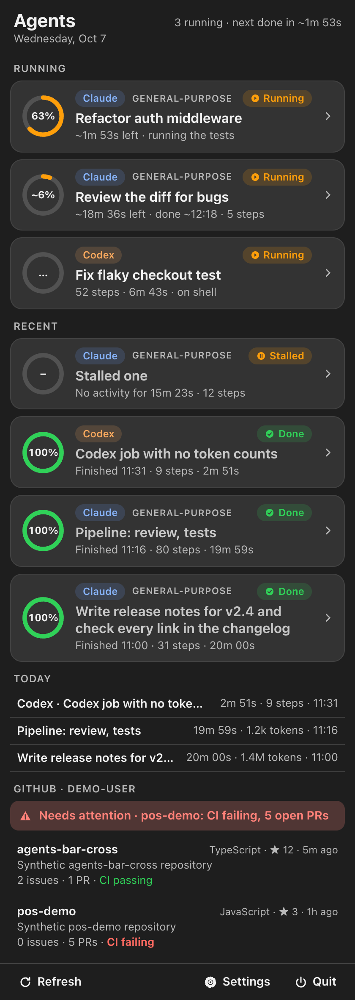
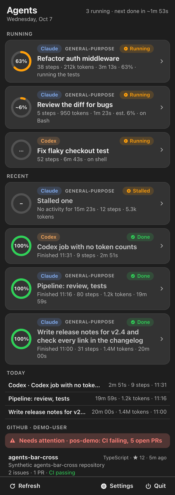
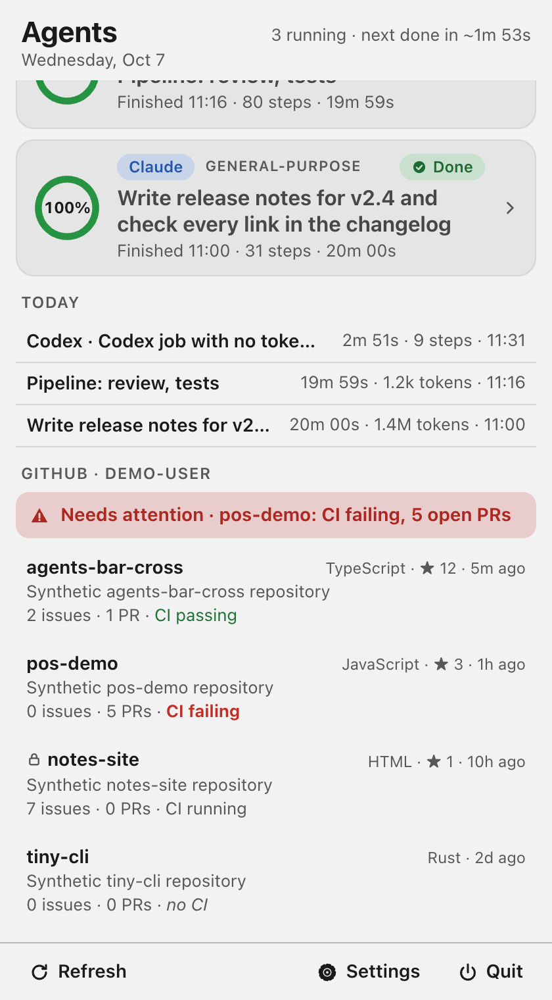

# Agents Bar gallery

More screenshots for the [README](../README.md). All of them use made-up sample data, never real data.

## Agents list

### Running and recent (dark)

Dark version of the main list, with percentages.

### Steps and tokens (light)

Agent numbers set to Steps + tokens.

### Steps, tokens and percentage (dark)

Agent numbers set to Both.

### Today and GitHub (light)

The Today list and the GitHub section with Needs attention.

